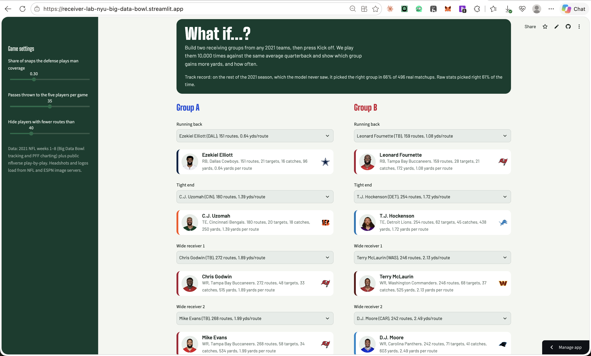
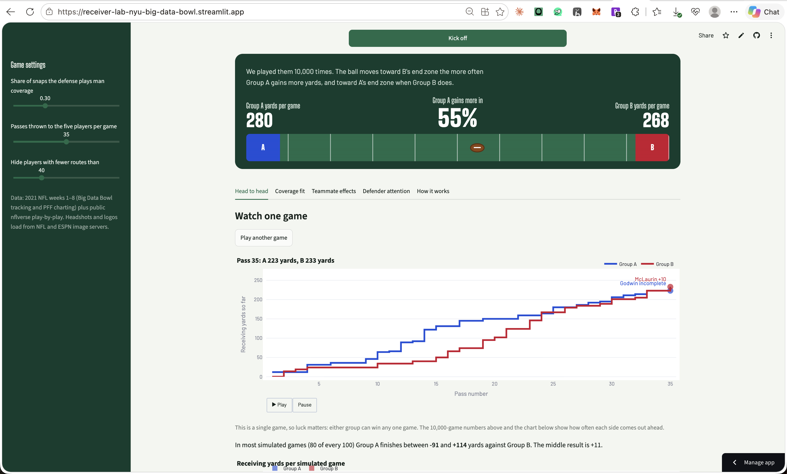

# What if...?

Every scout has a hunch about which receivers would light it up together. What if...? puts that hunch on the field: pick any five pass catchers from the 2021 season, play them 10,000 times, and see who actually gains the yards. On games it had never seen, it called the winner two times out of three.

What if...? lets a scout pick two receiving groups (one running back, one tight end and three wide receivers) from any 2021 NFL teams and play them against each other 10,000 times with the same average quarterback. Each player's simulated passes come from his real 2021 numbers for weeks 1–8: how often he was targeted per route, how often he caught the ball, and how far he took it, split by man and zone coverage and pulled toward the position average when his sample is small. Two things matter for scouts: only one player can catch each pass, so stacking high-volume receivers shrinks each one's share, and some groups hold up against both man and zone while others fall off against one. We tested the simulator on 2021 weeks 9–18, which it never saw, and it picked the group that gained more yards in 66% of 496 real team matchups, against 61% for raw stats. The data covers only passing plays from eight weeks, each player's numbers still reflect his real quarterback, and we could not measure chemistry between players who never shared a field.

Live app: https://receiver-lab-nyu-big-data-bowl.streamlit.app

Pick two groups, each with a profile card for every player:



Press Kick off for the 10,000-game result, then watch one simulated game pass by pass:



## Run it

```bash
pip install -r requirements.txt
streamlit run app.py
```

Everything the app needs is already in `data/`. To rebuild it from the raw Big Data Bowl files and the public nflverse play-by-play (`https://github.com/nflverse/nflverse-data/releases/download/pbp/play_by_play_2021.csv.gz`):

```bash
python build_data.py <BDB data dir> <play_by_play_2021.csv.gz>   # one row per route run -> data/routes.csv
python validate.py                                               # weeks 1-5 -> 6-8 checks
python validate_late.py <play_by_play_2021.csv.gz>               # weeks 1-8 -> 9-18, players
python validate_h2h.py <play_by_play_2021.csv.gz>                # weeks 1-8 -> 9-18, head to head
python build_gravity.py <BDB data dir>                           # positions at the throw
python gravity.py                                                # defender attention checks
python build_frames.py <BDB data dir>                            # snap-to-throw positions
python interplay_tests.py                                        # five teammate-effect tests
python build_playsim.py <BDB data dir>                           # real paths for the pass animation
```

## What's in the app

The page opens with the title and the simulator's track record. Below it are the two groups, with one dropdown per slot: a running back, a tight end and three wide receivers. Each dropdown lists only players at that position, and a card under it shows the chosen player's headshot, team logo and weeks 1–8 numbers. Kick off plays the two groups 10,000 times, then scrolls to a scoreboard where a football slides toward the losing side's end zone. The tabs below the scoreboard break the result down. If you change a player or a setting, the result hides until you press Kick off again.

| Tab | What it shows |
| --- | --- |
| Head to head | A pass-by-pass replay of one simulated game, an on-field animation of any pass from it, the spread of 10,000 games, and each player's share of targets |
| Coverage fit | Yards per game as the defense moves from all zone to all man, and each group's worst case |
| Teammate effects | What happens to receivers when the tight end blocks, and five tracking-data tests of teammate effects |
| Defender attention | How many extra coverage defenders each receiver drew at the throw |
| How it works | The model, the validation results and the limits |

## The on-field pass animation

Under the game replay, you can pick a quarterback (57 real QBs) and a defense and watch any simulated pass on the field. Your five players each run a route they really ran in 2021, the quarterback replays one of his real dropbacks, and the defenders replay a real snap of the chosen coverage against that quarterback. The ball goes to whoever the simulation targeted on that pass, and the targeted player's route comes from one of his real targets with a similar result. The routes come from different real plays and the defenders don't react to your receivers, so the animation illustrates a simulated pass; it doesn't predict how these players would move together. Tracking stops half a second after the throw, so the catch point is projected. `build_playsim.py` extracts the paths and `playsim.py` builds the animation.

## How the simulation works

Big Data Bowl data says who ran a route on each of the 7,565 pass attempts, and the public nflverse play-by-play says who was targeted and how many yards the play gained. We joined the two on game and play IDs and matched the targeted player to a route runner on the same play, which worked for 99.7% of targets.

In each simulated pass, the defense first calls man or zone. The quarterback then picks one of the five players in proportion to how often that player was targeted per route, and the player catches the ball at his own catch rate. The yards come from his real catches, mixed with his position's league-wide catches until he has enough of his own. No player has more than about 42 targets in these eight weeks, so each player's rates are blended with 60 routes and 20 targets of league-average play. A player with few routes therefore looks close to average, and a player with many looks like himself.

## Does it predict anything?

We built every player from weeks 1–8 and tested on weeks 9–18 of the same season, using the public nflverse play-by-play. For each team we took its most-targeted running back, tight end and three wide receivers in those later weeks and measured their receiving yards per team pass attempt. Then we checked, for all 496 pairs of teams, whether each method picked the group that gained more.

| Method, using weeks 1–8 only | Picked the winner | Correlation with actual (32 teams) |
| --- | --- | --- |
| Simulator | 66.1% | 0.49 |
| Raw yards per route of the same five players, added up | 61.1% | 0.32 |
| The team's own earlier passing numbers, which include its quarterback | 66.3% | 0.48 |

We also checked how many simulated games each matchup needs, running each count five times with different random seeds. With 10 games the simulator picked the winner 61.6% of the time on average (54.8% to 64.9% across runs), and with 100 games 62.2%. At 1,000 games it reached 65.9% (64.7% to 67.3%), and 10,000 games gave the same 65.9% with a tighter spread (65.5% to 66.5%). Past about 1,000 games, extra games only make the answer more stable. The app uses 10,000 so the "gains more in" figure barely moves between runs. Going further doesn't help either: 30,000 games picked the winner 66.0% of the time (65.5% to 66.7%) and 100,000 games 65.6% (65.5% to 65.7%), while one Kick off took 0.20 and 0.76 seconds against 0.07 seconds at 10,000. The remaining error comes from the player data, mainly having only eight weeks per player, and more simulated games can't fix that.

The simulator matches a baseline that knows the quarterback, even though it leaves the quarterback out on purpose so that groups from different teams can be compared fairly.

The same split works for single players. Because nflverse has no route data, the outcome here is receiving yards per team pass attempt in games where the player was targeted, for players with at least five such games.

| Players | Raw stats | Our model |
| --- | --- | --- |
| All 239 | 0.36 | 0.61 |
| 121 with fewer than 100 routes in weeks 1–8 | 0.03 | 0.34 |
| 118 with 100 or more routes | 0.60 | 0.65 |

Pulling small samples toward the average helps most where raw numbers are least reliable. For players with fewer than 100 routes, raw stats predicted almost nothing.

A shorter test, using weeks 1–5 to predict weeks 6–8, pointed the same way for players (0.33 for the model against 0.27 for raw stats, 127 players). At team level over those three weeks, a team's own earlier numbers did better (0.47 against 0.27), because they carry the quarterback. Simulated yards per pass also run higher than real ones (8.4 against 6.9), because every simulated pass goes to one of the five players and none are thrown away.

## What we tried that didn't make the cut

For every idea below, we wrote down the pass mark before running the test. A result counted only if its 90% range, estimated by resampling whole games, sat on the expected side of zero.

### Extra public data

Adding each player's 2020 season or his Next Gen Stats separation from weeks 1–5 barely changed predictions of weeks 6–8 yards per route (leave-one-out r of 0.288 and 0.298 against 0.284 without them; all three together, 0.293). Three weeks of routes is too noisy a target for better inputs to show.

### Defender attention

At the moment of the throw, we assigned each coverage defender to the route runner nearest to him and counted how many each receiver drew beyond what's normal for his position, depth and alignment. A player's number in odd weeks matched his even weeks only loosely (r = 0.24 for 158 players, below our 0.3 mark). Having high-attention teammates also didn't get a receiver more open (−0.41 yards of separation, 90% range −0.90 to +0.03). The app shows it as a description only.

### Route-depth mix

Basketball lineup studies measure synergy between player types instead of specific pairs, which would work for players who never played together. We tried that with route depth: does a group that mixes deep and short receivers gain more than its players predict on their own? Across 7,312 plays it didn't (+0.06 yards per pass per standard deviation of depth spread, 90% range −0.21 to +0.37). Mixing alignment widths gave +0.01, and the effect against man coverage was −0.10.

### Five tests from tracking data

As a check that separation is worth studying, completion rates rise from 50% at one yard of separation to 67% at four yards (6,846 targets).

| Test | Effect on separation | Effect on catches or yards |
| --- | --- | --- |
| A deep route on the same side, for underneath receivers | +1.1 yards (+0.95 to +1.26) | catch rate −3 points (−7 to +2); yards per target −0.2 (−0.9 to +0.5) |
| The same idea, using how often teammates run deep (a stable habit, r = 0.79) | +0.08 yards per standard deviation | yards per target −0.21 per standard deviation |
| Lining up within two yards of a teammate, against man coverage | +0.44 yards at the widest point of the route | yards per route −0.08 (−0.49 to +0.29) |
| Open space around the receiver, from a simple field-control model | high-attention teammates: −0.004 share of space (−0.009 to +0.001) | not tested |
| One player with and without a specific teammate (584 pairs) | not tested | odd and even weeks agree at r = 0.03 (−0.05 to +0.10) |
| Decoy value: defenders a receiver keeps away from the target | a loosely stable habit, r = 0.25 | teammates' catch rate +0.001 per standard deviation (−0.009 to +0.010) |

Teammates change how open a receiver gets, but over eight weeks that didn't reach catches or yards, and pair-specific results didn't repeat from one set of weeks to the next. The field-control model did predict catches slightly better than plain separation (AUC 0.73 against 0.71), which may be useful elsewhere.

The simplest teammate effect also turned out to be about volume. A receiver gains 1.71 more yards per route and 8.2 more points of target share when his tight end stays in to block (51 receivers, each compared with himself), mostly because one fewer route runner leaves more targets for him. The simulator already captures that through target competition, so it models target competition and coverage fit and nothing more.

## Limits

The data has passing plays only, from weeks 1–8 of 2021. The simulator assumes an average quarterback and pass protection, reduces coverage to man or zone, and drops plays charted as other coverages. Each player's numbers still reflect his real quarterback, scheme and play-calling. The data has no route labels, the tracking stops half a second after the throw, and the simulator does not model chemistry between specific players.
